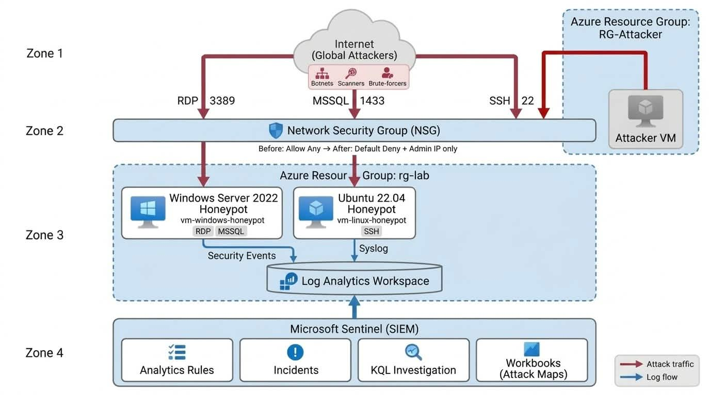
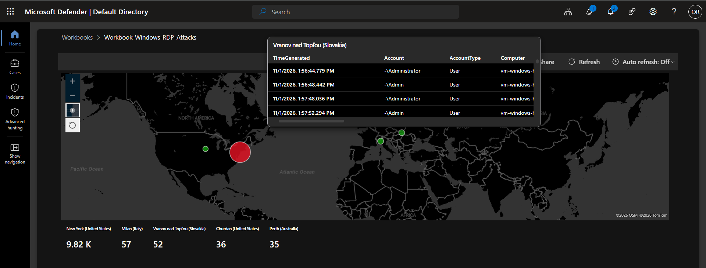
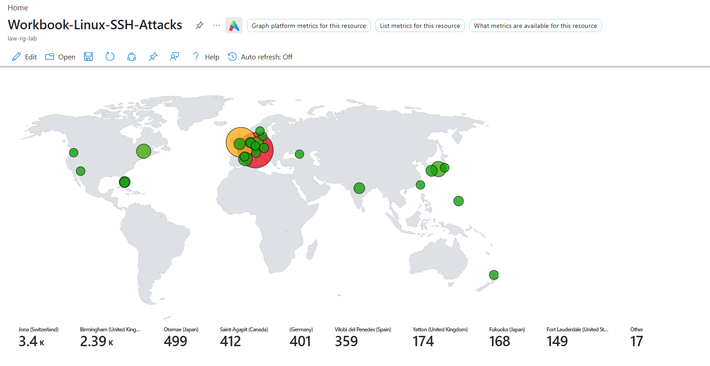
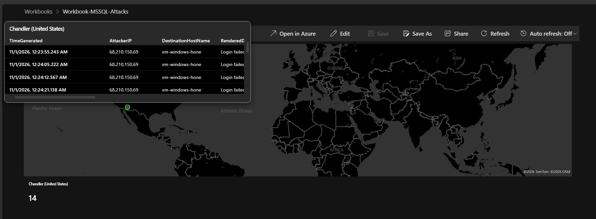
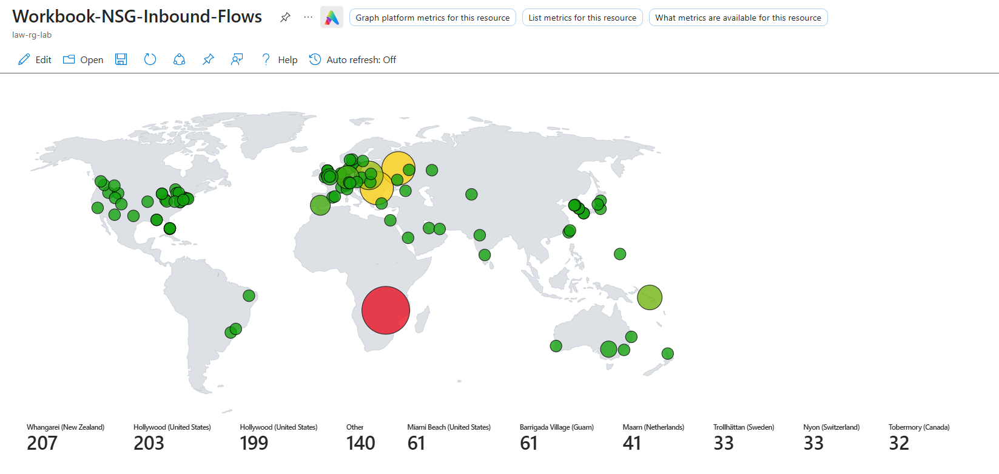
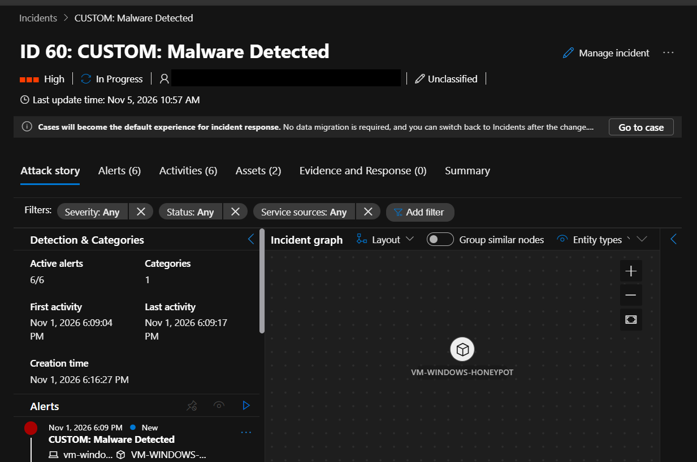
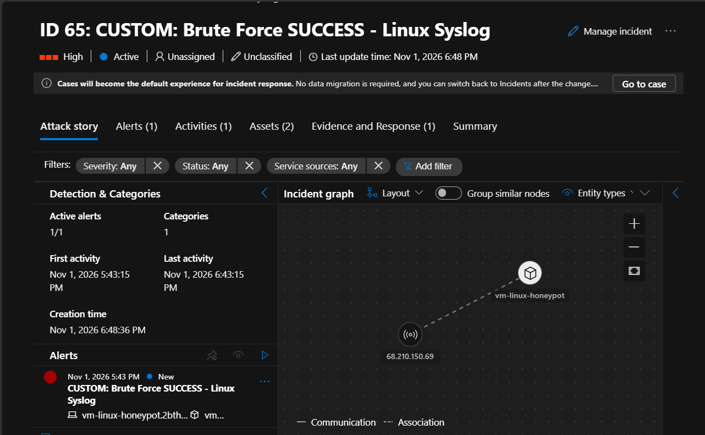
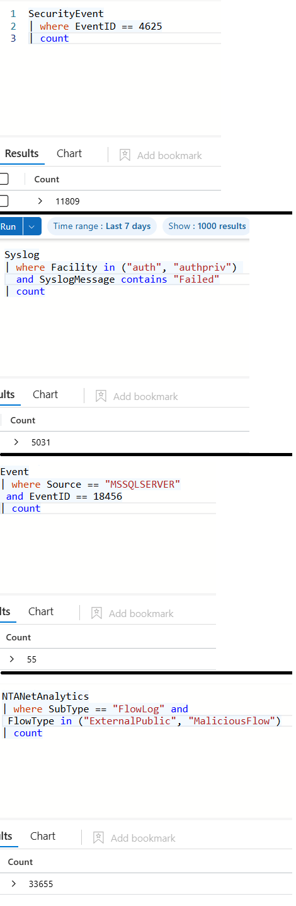
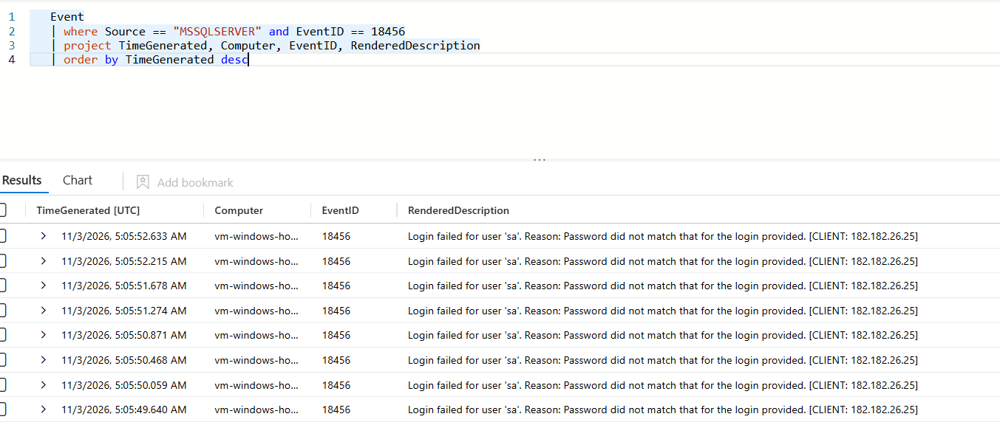
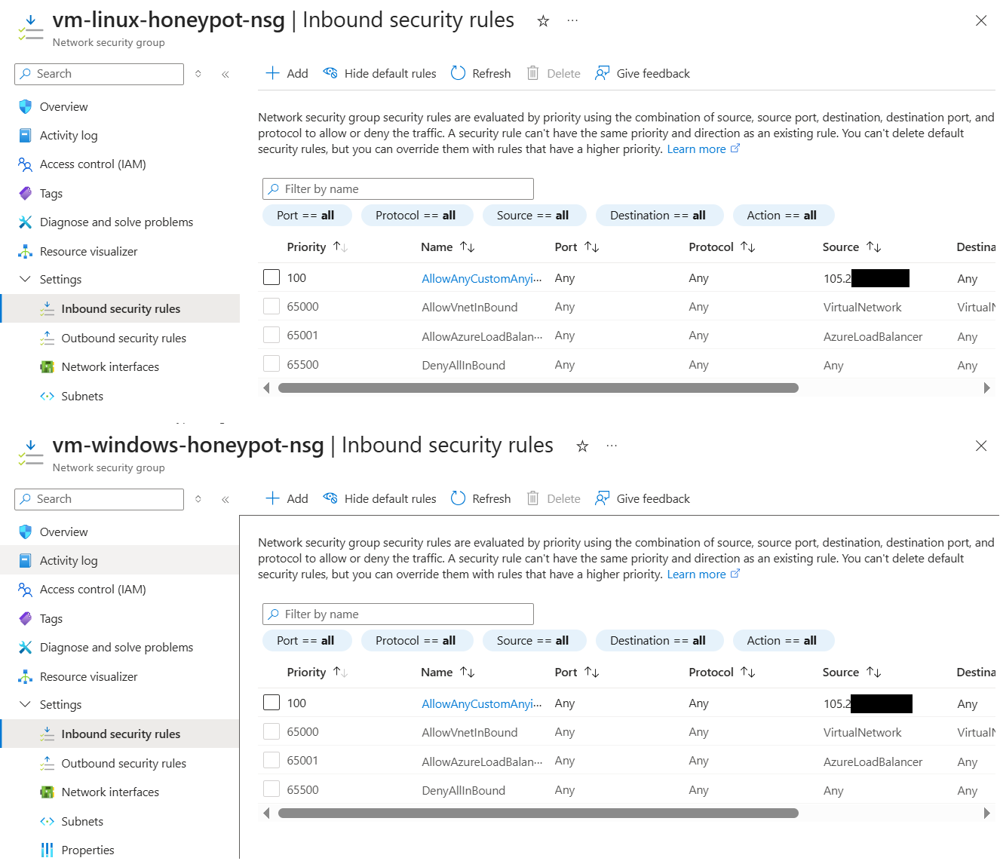

# Azure Cloud Honeynet & SOC Incident Response Lab


> An internet-facing Azure honeynet that attracted real-world attackers within hours, fed **Microsoft Sentinel** with live telemetry, and was used to run a full **SOC Tier-1/Tier-2 triage cycle** (detect, investigate, classify, contain, harden), with the results measured.

---

## Table of Contents
1. [Executive Summary](#1-executive-summary)
2. [Architecture](#2-architecture)
3. [Environment Specs](#3-environment-specs)
4. [Attack Scenarios](#4-attack-scenarios)
5. [Sentinel Workbooks (Attack Maps)](#5-sentinel-workbooks-attack-maps)
6. [SOC Triage Methodology](#6-soc-triage-methodology)
7. [KQL Query Library](#7-kql-query-library)
8. [Hardening & Impact](#8-hardening--impact)
9. [Cost Optimization Strategy](#9-cost-optimization-strategy)
10. [Lessons Learned](#10-lessons-learned)
11. [Repository Structure](#11-repository-structure)
12. [Evidence Index](#12-evidence-index)

---

## 1. Executive Summary

**Objective:** Deploy deliberately exposed Windows and Linux honeypots in Azure, collect real attack telemetry in Microsoft Sentinel, respond to the resulting incidents like a SOC analyst, and then quantify the effect of network hardening.

**What happened:** With RDP (3389), SSH (22) and MSSQL (1433) open to `0.0.0.0/0`, global scanners and botnets found the hosts within hours. Over the observation window the workspace recorded:

| Signal | Count | Source |
|---|---|---|
| Failed Windows logons (Event 4625) | **11,809** | `SecurityEvent` |
| Failed Linux SSH authentications | **5,031** | `Syslog` (auth/authpriv) |
| Failed MSSQL logins (Event 18456) | **55** | `Event` |
| Inbound external/malicious network flows | **33,655** | `NTANetAnalytics` |
| Sentinel / Defender incidents generated | **197** | Incident queue |

That is roughly **16,900 failed authentication events** across three services, plus 33K+ inbound flows from sources around the world.

**What I did:** Built 4 geo-mapped Sentinel workbooks, wrote custom KQL analytics and correlation queries, triaged every incident with a documented classification and MITRE ATT&CK mapping, hardened the NSGs, and then tore down the environment to stop billing, for a total spend of about **$17**.

---

## 2. Architecture

```
                         INTERNET  (global botnets, scanners, brute-forcers)
                                         |
                         RDP 3389 / MSSQL 1433 / SSH 22   (NSG: Allow Any, before hardening)
                                         |
        +--------------------------------v--------------------------------+
        |                  Azure Resource Group: rg-lab                   |
        |                                                                 |
        |   +----------------------+        +-------------------------+   |
        |   | vm-windows-honeypot  |        |   vm-linux-honeypot     |   |
        |   | Windows Server 2022  |        |   Ubuntu 22.04 LTS      |   |
        |   | RDP + MSSQL exposed  |        |   SSH exposed           |   |
        |   +----------+-----------+        +------------+------------+   |
        |              |  Security Events,               |  Syslog        |
        |              |  Defender, SQL logs             |  (auth)        |
        |   +----------+---------------------------------+------------+   |
        |   |   NSG + VNet Flow Logs  ->  NTANetAnalytics             |   |
        |   +----------------------------+----------------------------+   |
        |                                |                                |
        |   +----------------+           v                                |
        |   |  attacker-vm   |   +-----------------------------------+    |
        |   | (controlled    |   |  Log Analytics Workspace          |    |
        |   |  attack sims)  |   |  law-rg-lab                       |    |
        |   +----------------+   +----------------+------------------+    |
        +----------------------------------------|------------------------+
                                                 v
                      +---------------------------------------------------+
                      | Microsoft Sentinel + Defender for Cloud           |
                      |  - Custom analytics rules -> Incidents (197)      |
                      |  - 4 Workbooks (geo attack maps)                  |
                      |  - Triage -> Classify -> Close -> MITRE mapping   |
                      +----------------------------+----------------------+
                                                   v
                       NSG hardening  ->  VMs deallocated  ->  rg-lab deleted
```

> Optional: replace/augment this with a polished diagram, saved as `screenshots/00_architecture_diagram.png`.

---

## 3. Environment Specs

| Component | Detail |
|---|---|
| Resource group | `rg-lab` (deleted after evidence capture) |
| Windows honeypot | `vm-windows-honeypot`, Windows Server 2022; RDP 3389 and MSSQL 1433 exposed |
| Linux honeypot | `vm-linux-honeypot`, Ubuntu 22.04 LTS; SSH 22 exposed |
| Attacker node | `attacker-vm`, used for controlled brute-force and EICAR simulations |
| Log store | Log Analytics Workspace `law-rg-lab` |
| SIEM / XDR | Microsoft Sentinel (operated through the Microsoft Defender portal) and Defender for Cloud |
| Network telemetry | VNet Flow Logs, migrated from the legacy `AzureNetworkAnalytics_CL` table to the `NTANetAnalytics` schema |
| Tables used | `SecurityEvent`, `Syslog`, `Event`, `NTANetAnalytics` |

---

## 4. Attack Scenarios

Five vectors were exercised, mixing **controlled simulations** (from `attacker-vm`) with **real, unsolicited internet traffic**.

| # | Vector | Method | Telemetry |
|---|---|---|---|
| 1 | **Windows RDP brute force** | Scripted password guessing plus real internet bots; captured NTLM network logons (LogonType 3 and 10) | `SecurityEvent` 4625 / 4624 |
| 2 | **Linux SSH brute force** | Automated SSH auth attempts; success/failure tokens parsed from auth logs | `Syslog` |
| 3 | **Malware execution (EICAR)** | Dropped the EICAR test string at `C:\eicar.com` to trigger Defender | `Event` 1116 / 1117 |
| 4 | **MSSQL brute force** | Repeated login attempts against SQL Server (1433) | `Event` 18456 |
| 5 | **Unsolicited internet probing** | Open NSGs (`0.0.0.0/0`) attracted global scanners within hours | `NTANetAnalytics` |

**MITRE ATT&CK mapping:** T1110 Brute Force (Credential Access), T1110.001 Password Guessing, T1021.001 Remote Services: RDP.

---

## 5. Sentinel Workbooks (Attack Maps)

Four map-based workbooks built in KQL with IP geolocation enrichment:

| Workbook | Data | Highlights from the captures |
|---|---|---|
| `Workbook-Windows-RDP-Attacks` | Event 4625 | One source city dominated with **9.82K** failures; attempted accounts included `Administrator` and `Admin` |
| `Workbook-Linux-SSH-Attacks` | Syslog auth failures | Top sources: **3.4K** (Switzerland) and **2.39K** (UK), followed by Japan, Canada and Germany |
| `Workbook-MSSQL-Attacks` | Event 18456 | Repeated "Login failed" bursts seconds apart from one source IP |
| `Workbook-NSG-Inbound-Flows` | `NTANetAnalytics` (`ExternalPublic` and `MaliciousFlow`) | Flows from dozens of countries across every inhabited continent |

**How the workbooks work:** each one is a KQL map tile that joins the source IP against a Sentinel **watchlist named `geoip`** (columns: `network`, `latitude`, `longitude`, `cityname`, `countryname`) using `ipv4_lookup`. All four use a fixed **30-day** time range. The NSG workbook uses the same `NTANetAnalytics` filter as the headline flow count. Import steps are in [`workbooks/README.md`](workbooks/README.md).






---

## 6. SOC Triage Methodology

Every incident was handled with a consistent loop: **Detect, Investigate (KQL), Classify, Document, Contain / Harden.**

**Classification principle:** *Alert fidelity is separate from compromise outcome.* A failed brute-force attempt is still a **True Positive** because the detection correctly identified real hostile activity, even though no access was gained. Outcome (attempt vs success) is tracked through severity and the incident name.

| Incident | Alert | Investigation | Closure |
|---|---|---|---|
| **#60** | CUSTOM: Malware Detected | Queried Defender Operational logs; confirmed EICAR test file at `C:\eicar.com`, quarantined by real-time protection (Events 1116/1117) | Closed, True Positive, *Suspicious activity* |
| **#64, #175, #176** | CUSTOM: Brute Force SUCCESS, Windows | Correlated `SecurityEvent`; found an external IP (`182.182.26.25`) making repeated NTLM network probes (LogonType 3, `ANONYMOUS LOGON`); queued for NSG containment | Closed, True Positive, *Credential access* |
| **#65** | CUSTOM: Brute Force SUCCESS, Linux Syslog | Parsed auth-facility logs; verified SSH brute force followed by an accepted session | Closed, True Positive, *Credential access* |
| **#7** | Suspicious incoming RDP network activity | Consolidated Defender incident (11 alerts) between `attacker-vm` and `vm-windows-honeypot` | Closed, True Positive, *Security testing* |
| **Remaining** | CUSTOM: Brute Force ATTEMPT (Windows, Linux, MSSQL) | Bulk-triaged with MITRE T1110 mapping | Closed, True Positive |

> **Analyst note:** The "SUCCESS" alerts on Windows came from `ANONYMOUS LOGON` NTLM network logons (a common null-session / SMB probe pattern). These indicate successful *connection-level* authentication events, not confirmed account takeover. They were treated as credential-access activity and routed for containment.




---

## 7. KQL Query Library

Full files live in [`/kql`](kql/).

### A. Defender malware detection
```kql
Event
| where EventLog == "Microsoft-Windows-Windows Defender/Operational"
| where EventID in (1116, 1117)
| project TimeGenerated, Computer, EventID, RenderedDescription
```

### B. Windows authentication correlation (brute force to success)
```kql
SecurityEvent
| where EventID in (4625, 4624) and LogonType in (3, 10)
| where TimeGenerated > ago(7d)
| summarize
    FailedAttempts   = countif(EventID == 4625),
    SuccessfulLogons = countif(EventID == 4624),
    FirstAttempt     = min(TimeGenerated),
    LastAttempt      = max(TimeGenerated)
  by IpAddress, TargetAccount = TargetUserName, Computer
```

### C. NTLM / SMB network logon inspection
```kql
SecurityEvent
| where EventID == 4624 and Computer contains "vm-windows-hone"
| where TimeGenerated > ago(7d)
| project TimeGenerated, Computer, TargetUserName, IpAddress, LogonType, AuthenticationPackageName
| order by TimeGenerated desc
```
> The `Computer` field is truncated to the 15-character NetBIOS name (`vm-windows-hone`), so filtering on the full VM name returns nothing.

### D. Linux SSH authentication parsing
```kql
Syslog
| where Facility == "auth" and TimeGenerated > ago(7d)
| where SyslogMessage has_any ("Failed password", "Accepted password")
| parse SyslogMessage with * "for " TargetUser " from " SourceIP " port " *
| summarize
    Failures  = countif(SyslogMessage contains "Failed"),
    Successes = countif(SyslogMessage contains "Accepted")
  by SourceIP, TargetUser, HostName
```

### E. Inbound malicious network flows
```kql
NTANetAnalytics
| where SubType == "FlowLog" and FlowType in ("ExternalPublic", "MaliciousFlow")
| count
```

### F. Baseline counters (used for the Before/After comparison)
```kql
SecurityEvent | where EventID == 4625 | count

Syslog
| where Facility in ("auth", "authpriv") and SyslogMessage contains "Failed"
| count

Event | where Source == "MSSQLSERVER" and EventID == 18456 | count

NTANetAnalytics
| where SubType == "FlowLog" and FlowType in ("ExternalPublic", "MaliciousFlow")
| count
```

### G. MSSQL failed-login detail
```kql
Event
| where Source == "MSSQLSERVER" and EventID == 18456
| project TimeGenerated, Computer, EventID, RenderedDescription
| order by TimeGenerated desc
```




---

## 8. Hardening & Impact

**Change made:** Inbound rules on `vm-windows-honeypot-nsg` and `vm-linux-honeypot-nsg` were changed from **Allow Any** to a single rule that allows only the administrator's own IP, with everything else falling to the default `DenyAllInBound` (priority 65500).



| Metric | Source | Before (exposed) | After (hardened NSGs) |
|---|---|---|---|
| Windows RDP failed logons | `SecurityEvent` 4625 | **11,809** | 0 new external attempts expected |
| Linux SSH failed logons | `Syslog` auth | **5,031** | 0 new external attempts expected |
| MSSQL failed logins | `Event` 18456 | **55** | 0 new external attempts expected |
| Inbound external flows | `NTANetAnalytics` | **33,655** | 0 new external flows expected |
| Open incident queue | Sentinel / Defender | **197** | **0 active** (all triaged and closed) |

> **Transparency note:** The "after" attack figures reflect the effect of restricting the attack surface to a single trusted IP (default-deny for everyone else). The VMs were deallocated shortly afterwards to control cost, so the post-hardening result is a design outcome, not a long-running measurement. The incident queue reduction represents **triage completion**, not fewer attacks.

---

## 9. Cost Optimization Strategy

1. **Budget cap:** the whole lab cost about **$17**.
2. **Compute shutdown:** all VMs were stopped/deallocated once data collection finished.
3. **Analysis offline:** KQL investigations, baseline counts and triage were all completed with VMs off, using data retained in Log Analytics.
4. **Teardown:** after evidence capture, `rg-lab` was deleted so no resources remain to bill.

---

## 10. Lessons Learned

- **Exposure is punished almost immediately.** Default-open management ports drew thousands of attempts within hours; there is no "too obscure to be found."
- **Alert fidelity and outcome are different questions.** Classifying failed attempts as True Positives while tracking "SUCCESS" separately keeps metrics honest.
- **Context beats raw counts.** `ANONYMOUS LOGON` / NTLM LogonType 3 events can trigger "success" logic without meaning account compromise; correlation is essential.
- **Know your schema quirks.** Truncated NetBIOS hostnames and the move from `AzureNetworkAnalytics_CL` to `NTANetAnalytics` both broke queries until diagnosed.
- **Hardening can go further.** The restricted rule allows the admin IP on *any* port and protocol. A production design would scope it to specific ports and use Azure Bastion / JIT VM access instead of public management ports.
- **Cost discipline is a security skill.** Deallocating compute and deleting the resource group avoided both bills and a lingering attack surface.

---

## 11. Repository Structure

```
azure-soc-honeynet/
├── README.md
├── kql/
│   ├── 01_defender_malware_detection.kql
│   ├── 02_windows_auth_correlation.kql
│   ├── 03_ntlm_network_logon_inspection.kql
│   ├── 04_linux_ssh_parsing.kql
│   ├── 05_inbound_malicious_flows.kql
│   ├── 06_baseline_counters.kql
│   └── 07_mssql_failed_login_detail.kql
├── workbooks/
│   ├── Workbook-Windows-RDP-Attacks.json
│   ├── Workbook-Linux-SSH-Attacks.json
│   ├── Workbook-MSSQL-Attacks.json
│   └── Workbook-NSG-Inbound-Flows.json
├── screenshots/
│   └── (see Evidence Index)
├── docs/
│   ├── triage-playbook.md
│   └── architecture.md
└── LICENSE
```

---

## 12. Evidence Index

| File | Shows |
|---|---|
| `00_baseline_counts.png` | Baseline KQL counts (4625, SSH failures, 18456, NTA flows) |
| `01_incidents_queue_unfiltered.png` | Full incident queue before triage |
| `02_malware_incident_details.png` | Incident #60 (EICAR) detail |
| `03_malware_kql_investigation.png` | Defender events 1116/1117 |
| `04_malware_closing_comment.png` | Incident #60 closure: True Positive classification and analyst comment |
| `05_rdp_success_kql_correlation.png` | NTLM logons from external IP `182.182.26.25` |
| `08_linux_ssh_incident_details.png` | Incident #65 attack graph |
| `09_mssql_incident_details.png` | Incident #177 (MSSQL brute-force attempt) |
| `10_mssql_kql_investigation.png` | KQL output of MSSQL Event 18456 failed logins |
| `11_incidents_queue_resolved.png` | Queue filtered to Status: Resolved |
| `12_nsg_hardened_rules.png` | Hardened NSG inbound rules |
| `Workbook-*.png` | The four geo-map workbooks |

---

**Author:** Oussama Rebaii | [LinkedIn](https://www.linkedin.com/in/oussama-rebaii-a80b9a338/) | [GitHub](https://github.com/RebOussama)

*Built as a hands-on SOC portfolio project. All attacker traffic was either simulated from my own controlled node or passively observed on intentionally exposed honeypots in an isolated, now-deleted environment.*
